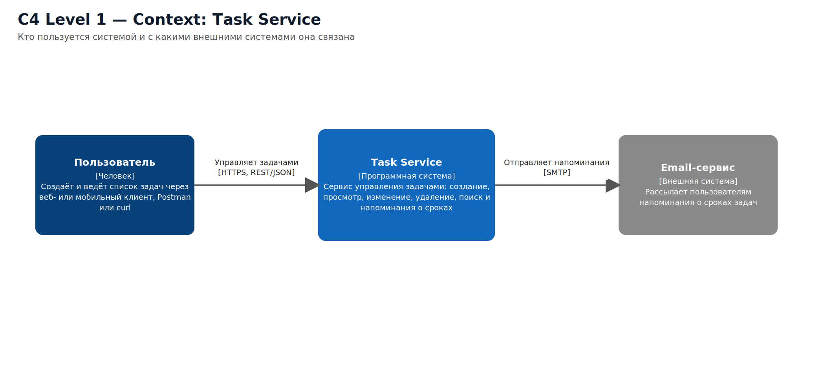
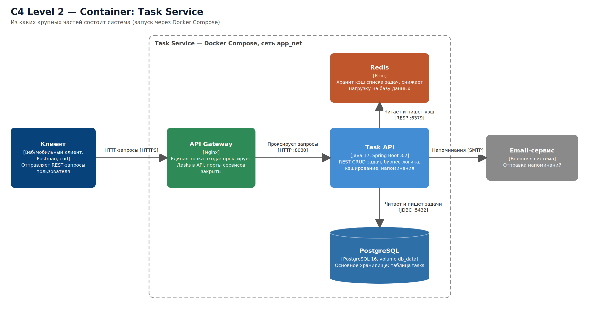
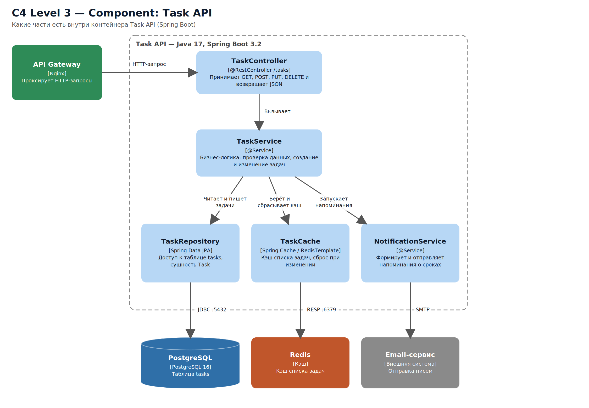

# Архитектура: Task Service (сервис задач)

## 1. Описание системы

**Task Service** — веб-сервис для ведения списка задач. Пользователь создаёт, просматривает, изменяет и удаляет задачи через REST API. Проект продолжает тему контрольной точки «Compose»: CRUD API на Java (Spring Boot) с базой PostgreSQL, запускаемые через Docker Compose.

**Основной пользовательский сценарий** (просмотр списка задач):
1. Клиент отправляет запрос `GET /tasks` в API Gateway.
2. API Gateway передаёт запрос в Task API.
3. Task API сначала ищет список задач в Redis. Если он там есть, возвращает его сразу.
4. Если списка в кэше нет, Task API читает задачи из PostgreSQL, кладёт результат в Redis и возвращает клиенту.
5. При создании, изменении или удалении задачи Task API записывает данные в PostgreSQL и сбрасывает кэш в Redis.
6. Для задач со сроком Task API отправляет напоминание через внешний Email-сервис.

Схемы: `c4-1-context.png`, `c4-2-container.png`, `c4-3-component.png` (общий файл `c4-architecture.pdf`). Редактируемый источник: `architecture.drawio` (три страницы, открывается на https://app.diagrams.net).

## 2. C4 Level 1 — Context

| Элемент | Роль |
|---|---|
| Пользователь | Работает со своими задачами через веб- или мобильный клиент, Postman или curl |
| Task Service | Система управления задачами |
| Email-сервис (внешняя система) | Рассылает пользователям напоминания о сроках |

Взаимодействие: пользователь отправляет REST-запросы в Task Service; Task Service отправляет напоминания во внешний Email-сервис.

## 3. C4 Level 2 — Container

| Контейнер | Технология | Роль |
|---|---|---|
| Клиент | Браузер, Postman, curl | Отправляет запросы пользователя |
| API Gateway | Nginx | Единая точка входа: проксирует запросы `/tasks` в API, внутренние порты наружу не открываются |
| Task API | Java 17, Spring Boot 3.2 | CRUD задач, бизнес-логика, кэширование, напоминания |
| PostgreSQL | PostgreSQL 16, volume `db_data` | Основное хранилище таблицы `tasks`, данные сохраняются после перезапуска |
| Redis | Кэш | Хранит кэш списка задач, разгружает базу данных |

Направление взаимодействия: Клиент → API Gateway → Task API → PostgreSQL и Redis; Task API → Email-сервис.

## 4. C4 Level 3 — Component (внутри Task API)

| Компонент | Роль |
|---|---|
| TaskController | REST-контроллер: принимает GET, POST, PUT, DELETE на `/tasks` |
| TaskService | Бизнес-логика: проверка данных, создание и изменение задач |
| TaskRepository | Слой доступа к данным (Spring Data JPA), сущность `Task`, работа с PostgreSQL |
| TaskCache | Работа с Redis (Spring Cache / RedisTemplate): чтение кэша и его сброс при изменениях |
| NotificationService | Формирует и отправляет напоминания о сроках во внешний Email-сервис |

Цепочка вызовов: API Gateway → TaskController → TaskService → TaskRepository / TaskCache / NotificationService.

## 5. Почему выбраны эти компоненты

- **Task API (Spring Boot)** — то, что уже реализовано в проекте: CRUD для сущности `Task`.
- **PostgreSQL** — надёжная реляционная база для структурированных данных о задачах, запускается отдельным сервисом `db`, данные хранятся в volume `db_data`.
- **Redis cache** — выбран как дополнительный компонент: список задач читается намного чаще, чем меняется, поэтому кэш снижает задержку ответа и нагрузку на PostgreSQL. Данные в кэше временные, источником истины остаётся PostgreSQL.
- **API Gateway (Nginx)** — одна точка входа: клиент знает только один адрес, а внутренние сервисы и их порты скрыты; на нём удобно добавлять авторизацию и ограничение запросов.

## 6. Текущее состояние и план

Уже реализовано в проекте: Task API и PostgreSQL в Docker Compose (контрольная точка «Compose»). API Gateway, Redis и уведомления показаны как целевая архитектура и запланированы по дорожной карте проекта (спринты 3–8).
